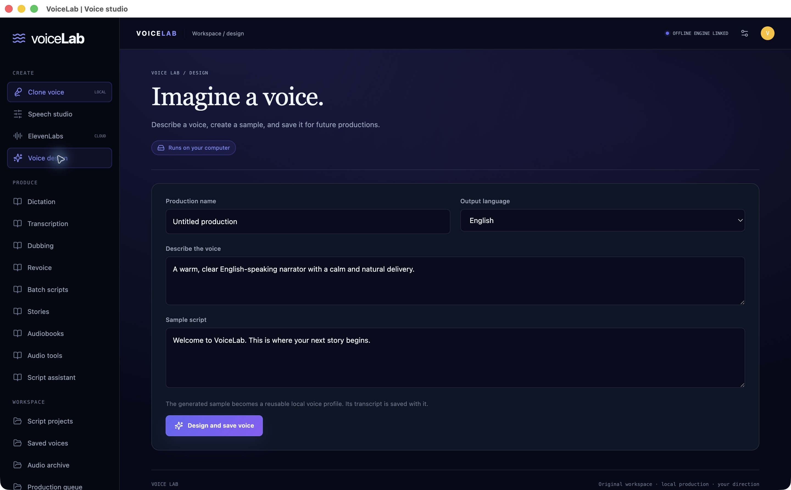
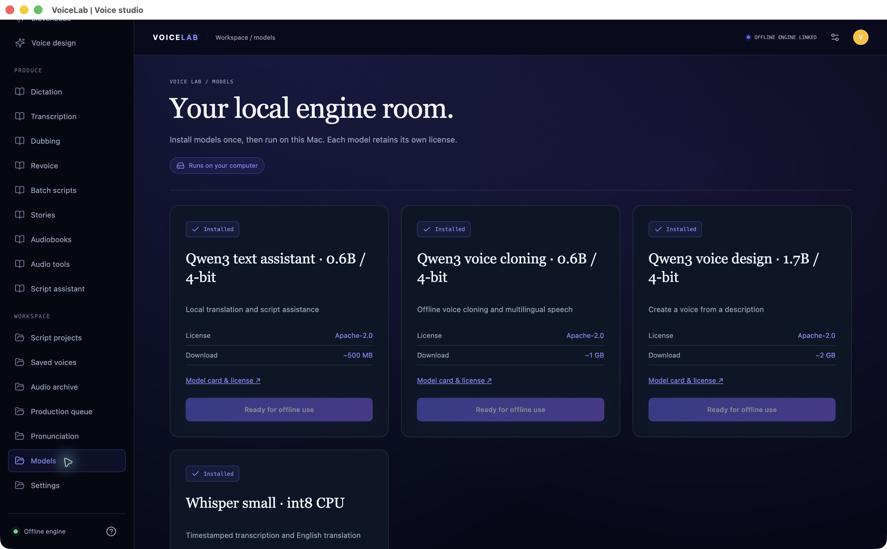

# VoiceLab

**A local-first voice-production studio by Karla Offerman.**

Record a voice reference, turn scripts into speech, and produce stories, transcripts, dubs, and audiobooks from one workspace. Offline processing is the default; ElevenLabs is an optional, explicitly selected cloud engine.

**Status:** working Apple Silicon prototype · **Source:** private / proprietary · **Last updated:** October 2026

## For recruiters and reviewers

VoiceLab brings together a desktop interface, a local inference service, and durable media-production workflows. This repository provides a public product and engineering overview without distributing the application source, model weights, or private recordings.

**Project owner:** [Karla Offerman · @K-Diamonds](https://github.com/K-Diamonds). For a walkthrough or a confidential source review, [open a review request](https://github.com/K-Diamonds/VoiceLab-showcase/issues/new?template=review-request.yml). Please do not include private information in the public issue.

This is a personal project, not an ElevenLabs product or an affiliated integration showcase. The application was implemented with AI assistance using third-party inference libraries and pretrained models. It does not claim original research or training of those models.

## Request access to the private source

Recruiters and technical reviewers can **[request access to the private VoiceLab repository](https://github.com/K-Diamonds/VoiceLab-showcase/issues/new?template=repository-access.yml)**.

Include your GitHub username, review purpose, and expected review duration. Karla Offerman reviews each request and may invite the approved account to **K-Diamonds/VoiceLab**. Access is not automatic; the source repository remains private. The request is a **public issue**, so include only information you are comfortable publishing.

## What it does

| Workflow | Current behavior |
| --- | --- |
| Voice cloning | Record or upload a reference; a visible read-aloud passage supplies the recording transcript; save a reusable local voice profile. |
| Speech studio | Generate, preview, download, and retain audio takes; select local or optional ElevenLabs processing. |
| Voice design | Describe a voice and generate a reference that can be reused in later productions. |
| Transcription and dictation | Transcribe files or a microphone recording locally; export text and timed SRT/VTT subtitles. |
| Dubbing and revoicing | Edit timed dialogue, choose segment voices, translate locally, and fit generated speech to the source timeline. |
| Stories and batch scripts | Cast a voice per block; queue multiple scripts; export combined audio and individual takes. |
| Audiobooks | Produce chapters and an M4B with chapter markers and metadata. |
| Audio tools | Denoise, normalize loudness, remove silence, adjust pace, and convert formats. |
| Production management | Save projects, monitor persistent jobs, cancel or retry work, manage models, and back up the workspace. |

## Engineering overview

- **Interface:** React, TypeScript, Vite, and a custom navy/indigo design system.
- **Desktop:** Electron shell with isolated renderer context and Node integration disabled.
- **Application API:** Node.js / Express routes separate local processing from optional cloud calls.
- **Inference service:** Python / FastAPI, MLX Audio and MLX LM on Apple Silicon, Faster Whisper on CPU.
- **Media:** FFmpeg for decoding, timing, cleanup, conversion, and audiobook packaging.
- **Persistence:** SQLite for voices, projects, outputs, and job state; local files for media; browser storage for drafts and recent takes.

See [architecture and engineering decisions](docs/architecture.md), [verification and limitations](docs/verification.md), and the [demo walkthrough](docs/walkthrough.md).

## Model management

Models are installed explicitly. Normal installed-model inference uses local paths, and failed local requests do not switch to a cloud service automatically. Third-party models and libraries retain their upstream licenses.

## What has been verified

Real on-device tests have exercised voice design, reference-conditioned cloning, transcription, stories, batch generation, chaptered M4B export, audio cleanup, timed dubbing, revoicing, and local text generation. Regression coverage includes browser WebM recordings without duration metadata, media conversion, chapter markers, queue cancellation/recovery, and API proxy behavior.

The recorded verification is from an Apple M3 Pro development machine. It is not a production benchmark, independent audit, or cross-platform certification. ElevenLabs live account access has not been verified without an API key.

## Current boundaries

This is an actively developed prototype. Current limits include ten local speech-language choices, record/stop dictation, speaker-label suggestions that require review, and a desktop development launcher rather than a signed installer. Dubbing replaces the original audio track; revoicing is transcript-based resynthesis. There is no public hosted inference service or application download in this repository.

## Access and rights

The full source is maintained in a separate **private repository**. Source review may be offered by invitation. Public showcase screenshots and documentation are © 2026 Karla Offerman; see [LICENSE](LICENSE). GitHub's normal platform viewing and copying functionality still applies to this public repository. The showcase is not an open-source release of the VoiceLab application.
