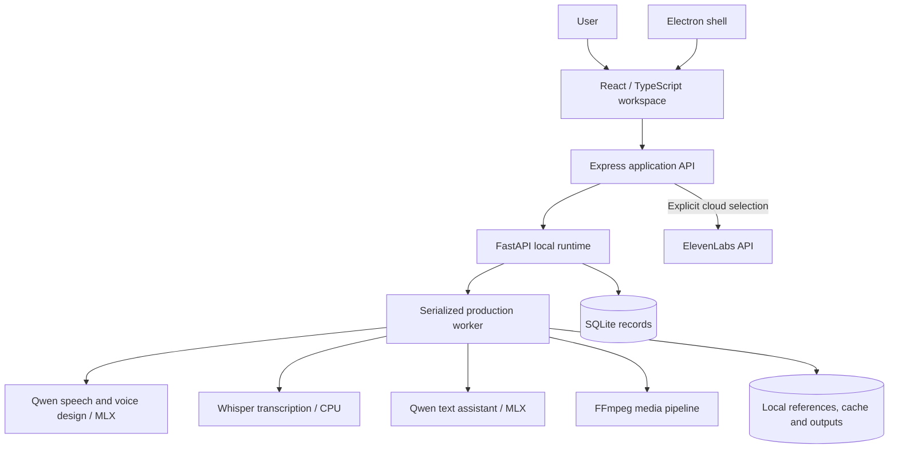

# Architecture

VoiceLab separates editing, inference, media processing, and persistence so a model operation does not need to own the entire product workflow.

## Decisions worth reviewing

**Local and cloud routes are separate.** A user chooses cloud processing explicitly; a local failure does not send content to ElevenLabs as a fallback. Model installation is distinct from normal local generation.

**Profiles, projects, and takes are separate records.** A saved voice retains its reference recording and transcript. A production project describes editable blocks and casting. Generated output is a file with metadata, rather than a replacement for the editable project.

**Inference is serialized.** A single production worker bounds concurrent GPU demand on the development Mac. Switching model families releases the prior model before loading another. The tradeoff is lower concurrency.

**Long-form work has recovery points.** Job state is persisted in SQLite; a restart marks active work interrupted. Retry reuses finished chapter/block files and cached speech segments. Cancellation is cooperative at stage or segment boundaries.

**Media is validated at ingestion.** References are decoded and normalized to mono 24 kHz. Browser WebM files that omit duration metadata are measured through decoding instead of rejected solely for missing metadata.

**The desktop renderer is isolated.** Electron uses context isolation, disables renderer Node integration, and restricts navigation. The service endpoints are loopback-bound. This is an architectural description, not a security audit.

## Provenance

The application implementation was written independently after reviewing a reference project's feature categories. It is not a fork and does not import that project's application source or assets. Implementation was AI-assisted. MLX, Qwen, Whisper, FFmpeg, Electron, React, and other dependencies remain third-party technologies with their own rights and licenses.
